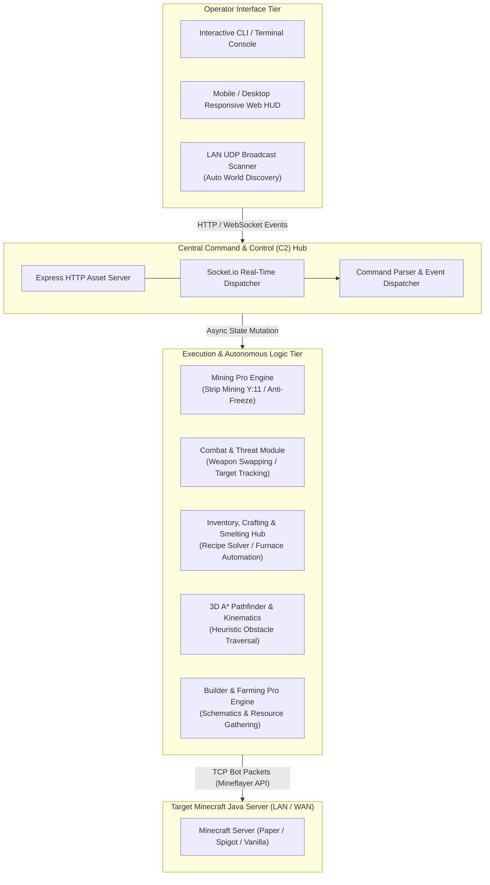

<div align="right">
  <strong>English</strong> | <a href="README.pt-BR.md">Português</a>
</div>

# Minebot C2 Engine 🤖⛏️

[](https://nodejs.org/)
[](https://github.com/PrismarineJS/mineflayer)
[](https://socket.io/)
[](https://github.com/PrismarineJS/mineflayer-pathfinder)
[](LICENSE)

> **Autonomous Autonomous Agent & Command & Control (C2) Orchestrator for Minecraft Java.**  
> Engineered with a decoupled modular architecture, real-time WebSocket telemetry, anti-freeze deep mining routines, heuristic threat mitigation, and local network (LAN) auto-discovery.

---

## 📌 Architectural Pipeline (C2 Topology)

The engine decouples low-level packet-driven gameplay execution from the operator command plane through a bidirectional WebSockets hub.



---

## ⚙️ Core Engineering Achievements

### 1. Anti-Freeze Subterranean Mining (`module_mining_pro.js`)
- Solves desynchronization and server-side block state lags during deep strip mining:
  - Validates block state assertions prior to issuing dig packets.
  - Implements safe stair-step excavation routines down to diamond level (`Y: 11`).
  - Graceful exception interception preventing infinite pathfinding recursion or connection timeouts on bedrock collisions.

### 2. Dual-Interface Command & Control (C2)
- Operators can monitor and control bot instances either through an interactive terminal stream or via a mobile-optimized responsive web dashboard over WebSockets.
- Real-time inventory status, vital stats (HP, food level), current coordinates, and task progress streamed with sub-50ms latency.

### 3. Reactive Combat & Threat Mitigation (`module_combat.js`)
- Continuously scans bounding volumes for hostile entities within threat perimeters.
- Automatically equips optimal available weaponry (swords, axes) based on attack cooldown timings and executes tactical hit-and-run strafing.

### 4. Automatic LAN World Discovery (`lan_scanner.js`)
- Intercepts local network UDP broadcast packets (`224.0.2.60:4445`) emitted by single-player worlds opened to LAN, completely removing manual IP/port configuration overhead.

---

## 🛠️ Modular Subsystem Breakdown

| Subsystem File | Responsibility | Key Engineering Patterns |
| :--- | :--- | :--- |
| **`index.js`** | Core lifecycle orchestrator and C2 bootstrapper | Express & Socket.io server, asynchronous event listeners |
| **`module_mining_pro.js`** | Advanced strip mining and subterranean navigation | Safe dig execution, Y-level step progression, anti-desync checks |
| **`module_combat.js`** | Entity tracking, threat response, and weapon prioritization | Nearest-target heuristic sorting, equipment state mutation |
| **`module_crafting.js`** | Recipe graph resolution and workbench crafting | Dependency resolution for item manufacturing |
| **`module_inventory.js`** | Inventory indexing, hotbar management, and equipment | Tool ranking metrics, slot index normalization |
| **`lan_scanner.js`** | Zero-configuration local network discovery | Multicast UDP socket listening |

---

## 🚀 Execution & Quick Start

### Requirements
- Node.js 18.0.0 or higher
- Target Minecraft Java Server (1.18.x - 1.21.x supported via protocol negotiation)

```bash
# 1. Clone the repository
git clone https://github.com/welzim19-star/minebot-c2-engine.git
cd minebot-c2-engine

# 2. Install dependencies
npm install

# 3. Start the C2 Engine & Autonomous Bot
node index.js
```

### Accessing the Web Dashboard
Open your browser or mobile phone connected to the same network:
```text
http://localhost:3000
```

---

## ⚖️ Ethical & Educational Disclaimer
*Minebot C2 Engine is engineered strictly for academic research in autonomous robotics simulation, distributed state management, and algorithmic pathfinding within virtual sandbox environments. Ensure you comply with the terms of service of any multi-user server before deploying autonomous agents.*
