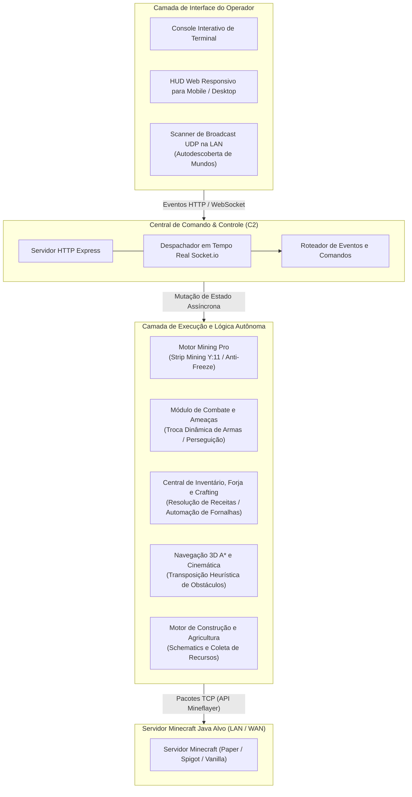

<div align="right">
  <a href="README.md">English</a> | <strong>Português</strong>
</div>

# Minebot C2 Engine 🤖⛏️

[](https://nodejs.org/)
[](https://github.com/PrismarineJS/mineflayer)
[](https://socket.io/)
[](https://github.com/PrismarineJS/mineflayer-pathfinder)
[](LICENSE)

> **Agente Autônomo e Orquestrador Command & Control (C2) para Minecraft Java.**  
> Desenvolvido com arquitetura modular desacoplada, telemetria em tempo real via WebSockets, rotinas de mineração subterrânea com proteção anti-freeze, mitigação reativa de ameaças e autodescoberta de servidores em rede local (LAN).

---

## 📌 Pipeline Arquitetural (Topologia C2)

O motor desacopla a execução das ações no mundo virtual do plano de comando do operador por meio de um hub bidirecional de WebSockets.



---

## ⚙️ Conquistas Centrais de Engenharia

### 1. Mineração Subterrânea com Proteção Anti-Freeze (`module_mining_pro.js`)
- Soluciona problemas de dessincronização e lentidão no estado de blocos durante escavações profundas:
  - Validações de integridade do bloco antes de emitir pacotes de quebra.
  - Rotinas seguras de escavação em escadaria até o nível de diamantes (`Y: 11`).
  - Intercepção de exceções para prevenir loops infinitos de pathfinding ou desconexões por colisão com bedrock.

### 2. Central Command & Control (C2) de Canal Duplo
- O operador pode monitorar e despachar comandos tanto pelo terminal interativo quanto por uma interface web responsiva otimizada para smartphones via WebSockets.
- Transmissão com latência inferior a 50ms de coordenadas em tempo real, status de inventário, nível de fome e barra de vida.

### 3. Combate Reativo e Mitigação de Ameaças (`module_combat.js`)
- Varredura contínua do volume delimitador em busca de entidades hostis.
- Equipamento automático da melhor arma disponível (espadas, machados) calculando o cooldown de ataque e movimentação tática de afastamento.

### 4. Autodescoberta de Mundos na Rede Local (`lan_scanner.js`)
- Escuta pacotes multicast UDP (`224.0.2.60:4445`) emitidos pelo Minecraft ao abrir para LAN, eliminando a necessidade de digitar IPs e portas manualmente.

---

## 🛠️ Detalhamento dos Módulos do Sistema

| Arquivo do Módulo | Responsabilidade | Padrões de Engenharia |
| :--- | :--- | :--- |
| **`index.js`** | Orquestrador central e inicializador do hub C2 | Servidor Express/Socket.io, listeners de eventos assíncronos |
| **`module_mining_pro.js`** | Mineração profunda e navegação subterrânea | Escavação segura, progressão em camadas Y, mitigação de desync |
| **`module_combat.js`** | Rastreamento de entidades, combate e armas | Ordenação heurística por proximidade, mutação de estado de equipamento |
| **`module_crafting.js`** | Resolução do grafo de receitas e fabricação | Resolução de dependências para manufatura de itens |
| **`module_inventory.js`** | Indexação de inventário, hotbar e ferramentas | Classificação por eficácia, normalização de slots |
| **`lan_scanner.js`** | Descoberta sem configuração em rede local | Socket UDP multicast |

---

## 🚀 Execução & Início Rápido

### Requisitos
- Node.js 18.0.0 ou superior
- Servidor de Minecraft Java ativo (versões 1.18.x até 1.21.x suportadas por negociação automática)

```bash
# 1. Clonar o repositório
git clone https://github.com/welzim19-star/minebot-c2-engine.git
cd minebot-c2-engine

# 2. Instalar dependências
npm install

# 3. Iniciar o orquestrador C2 e o bot
node index.js
```

### Acessar a Interface Web
Abra o navegador no computador ou no celular conectado à mesma rede:
```text
http://localhost:3000
```

---

## ⚖️ Aviso Legal & Uso Acadêmico
*O Minebot C2 Engine foi projetado exclusivamente para fins de pesquisa em robótica virtual, gerenciamento de estado distribuído e algoritmos de pathfinding em ambientes virtuais sandbox. Respeite sempre os termos de serviço dos servidores em que for operar.*
